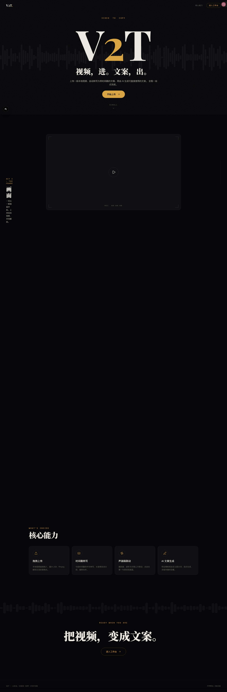
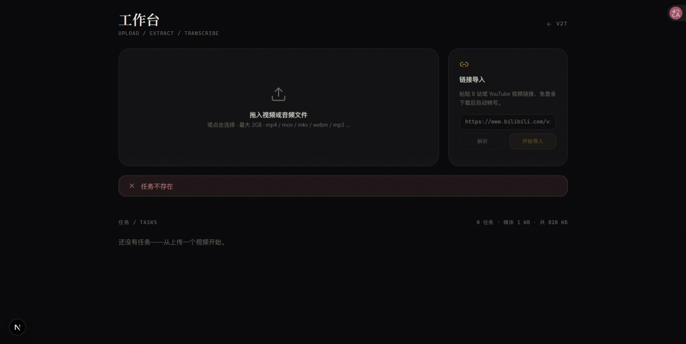

<div align="center">

# V2T · 声画内容工作台

**把视频变成能读、能回看、能追问的图文**

[](https://nextjs.org)
[](https://react.dev)
[](https://www.typescriptlang.org)
[](https://nodejs.org/api/sqlite.html)
[](https://ffmpeg.org)

上传本地视频或粘贴 B 站 / YouTube 链接，自动转写、抽帧，并生成**带时间出处与真实画面**的图文文章；还可以围绕视频提问。

</div>

播放器、波形、文稿三方联动：点击文稿跳到对应画面，点击波形跳到对应句子，文章里的每个论断都能顺着编号回到视频里的那一秒。

## 界面

### 工作台：拖入文件或粘贴链接



### 任务页：播放器、文稿与文章三方联动



## 核心能力

- **两种来源，免登录可用**：拖入本地视频（默认 ≤2GB），或粘贴 B 站（含分 P）/ YouTube 链接。不登录也能拿到可用清晰度；配置 Cookie 后可解锁更高画质与平台字幕。
- **转写优先用字幕**：优先使用容器内字幕，覆盖率不足时自动回退 ASR；句级时间戳，超过 10 分钟自动分段后合并（`ASR_CHUNK_SECONDS` 可调）。
- **正文配真实画面**：就绪后抽取覆盖全片的全景帧，文章按段落插入对应的真实画面，而不是占位图。
- **带出处的问答**：回答标注转写稿出处，并显式列出「未确认之处」，点编号直接跳回视频时间。
- **AI 文案多版本**：4 个预设模板或自定义提示词，流式输出，保留历史版本。
- **存储自动治理**：源视频 / 音频 / 画面帧按天清理（默认 7 天），转录稿与文案永久保留。

## 处理流程

```
本地上传 | 链接导入 → 字幕优先 / ffmpeg 抽音频 → ASR 转写（长音频自动分段）
→ 全景抽帧 → 文稿/画面联动浏览 → 图文文章 | AI 文案 | 证据问答
```

图文文章分两步生成：先出提纲，再逐章成文，每章都带着可核对的时间与画面出处。

## 多端与任务归属

任务按**设备**隔离：首次访问时服务端下发一个随机 `v2t-device` cookie（HttpOnly），
任务落库时记在 `tasks.owner`，列表、详情、文稿、音视频流、队列都只返回本设备的任务，
别人的任务按 404 处理。没有账号体系，所以这是**防串台的软隔离，不是鉴权**：

- 同一个 cookie 的浏览器（多标签页）共享任务；换浏览器 / 清 cookie 就等于换了新设备，看不到旧任务。
- 加隔离之前创建的历史任务（`owner` 为空）会被**第一台**访问的设备认领一次。
- 服务本身仍不设登录；要对公网开放，请在前面加一层反向代理鉴权。

## 适合什么视频

技术讲解、科普、课程和操作教程这类**讲述清晰**的视频最适合。音乐、风景或纯剪辑视频可提取的信息较少；静态画面也无法完整表达连续动作、节奏或剧情。结果会受字幕质量、音质、画面清晰度和模型服务影响。

## 依赖

- **Node.js ≥ 22.5**（使用内置 `node:sqlite`，无需编译原生模块）
- **ffmpeg**（含 ffprobe），需在 PATH 中
- **yt-dlp**（可选），仅链接导入需要

```bash
ffmpeg -version    # 必须有输出
yt-dlp --version   # 可选
```

## 快速开始

```bash
bash scripts/setup.sh        # 校验依赖 → 安装 npm 包 → 生成 .env
bash scripts/start-prod.sh   # 构建 + 生产模式 → http://localhost:4317
```

Windows：

```bat
scripts\setup.bat
scripts\start-prod.bat
```

首次运行请在 `.env` 填好 `SILICONFLOW_API_KEY`（转写）和 `LLM_API_KEY`（文案 / 图文 / 问答）。

## 启动方式

| 命令 | 说明 |
| --- | --- |
| `scripts/start-prod.sh` / `.bat` | 对外提供服务：构建后以生产模式运行，零配置 |
| `scripts/start-dev.sh` / `.bat` | 本机开发：热更新，不构建，仅 localhost 默认放行 |
| `--port 8080` 或 `V2T_PORT=8080` | 改端口，默认 **4317** |
| `--skip-build` | 生产模式复用已有 `.next` 产物，快速重启 |
| `--help` | 查看全部参数 |

`scripts/start.sh` 仍可直接用，加 `--dev` 切换模式。

## 配置（.env）

| 变量 | 说明 | 默认 |
| --- | --- | --- |
| `SILICONFLOW_API_KEY` | 转写 API Key | 必填 |
| `ASR_MODEL` | 转写模型 | `XingChenAGI/XingChenASR-V3.2-Ultra` |
| `LLM_API_KEY` | 文案 / 图文 / 问答 API Key | 必填 |
| `LLM_BASE_URL` | LLM 的 OpenAI 兼容端点 | `https://open.bigmodel.cn/api/paas/v4` |
| `LLM_MODEL` / `LLM_VISION_MODEL` | 文本模型 / 视觉模型 | `glm-4.6` / `glm-4.6v` |
| `DOWNLOADER_COOKIES_FILE` | 链接导入的登录 Cookie（Netscape 格式） | 空 = 免登录 |
| `MAX_UPLOAD_GB` | 上传上限 | `2` |
| `MEDIA_RETENTION_DAYS` | 媒体保留天数 | `7` |
| `DATA_DIR` | 数据库与任务媒体目录 | `./data` |
| `LOG_LEVEL` | 日志级别：`debug` / `info` / `warn` / `error` | `info` |
| `LOG_STACK` | 设为 `1` 时错误日志附带堆栈 | 空 |
| `ALLOWED_DEV_ORIGINS` | 仅开发模式：允许的远程 host（逗号分隔，不入库） | 空 |

### 关于 B 站下载

机房 IP 常被 B 站风控返回 412。程序会自动改走官方内容接口兜底，拿到 **720P 单文件**，足够抽帧与转写。想要更高清晰度或平台字幕，需导出登录态 Cookie：

1. 浏览器登录 B 站，用扩展导出 Netscape 格式的 cookies.txt；
2. `.env` 设置 `DOWNLOADER_COOKIES_FILE=/绝对路径/cookies.txt`；
3. 重启服务。

## 开发

```bash
npm run dev        # 开发服务器（4317）
npm run build      # 生产构建
npm run lint       # ESLint
npm run typecheck  # tsc --noEmit
npm test           # vitest（服务层）
```

远程访问开发服务器时，Next 16 会拦截非 localhost 的 `/_next` 资源（表现为热更新不生效）。本机开发无需处理；确需远程调试热更新，才在 `.env` 设 `ALLOWED_DEV_ORIGINS=<你的 host>`。对外提供服务请直接用 `start-prod`，不涉及该限制。

### 本地 CI

```bash
bash scripts/ci.sh   # 或 npm run ci
```

依次执行 lint → typecheck → test → build，任一步失败立即退出；首次运行会先 `npm ci`。只产出可部署构建，不配置远端、不自动部署。构建默认限制 1G 堆内存，构建期间建议停掉 `next dev` 以避开内存峰值。

## 日志

服务端输出 logfmt 单行日志（`时间 level=INFO msg="..." key=value`），写到 stdout/stderr：

- 覆盖任务管线、上传 / 链接导入、ASR、LLM 调用、图文文章、问答、文案生成与媒体清理
- 只记录事件和上下文（task_id、request_id、model、耗时、字节数等），不记录提示词、转写稿或 API Key
- 所有 `/api/*` 响应带 `X-Request-ID`，SSE 的 `error` 事件带 `request_id`；排查时把该值贴给服务端即可定位整条调用链
- `LOG_LEVEL=debug` 可看逐段 ASR / 抽帧细节；`LOG_STACK=1` 让错误日志附带堆栈
- 生产环境交给 journald，或直接重定向：`bash scripts/start-prod.sh --skip-build > app.log 2>&1`

## 桌宠

右下角挂了一只可拖动、会追光标的桌宠。运行时是 `public/pet-embed/pet.js`（零依赖，其他项目一句 `<script>` 就能引用），素材在 `public/pets/`；header 的猫按钮或宠物自身的悬停工具条可以换角色、隐藏、切静态模式。桌宠跟随业务状态：导入开始奔跑、排队等待、处理时检查、完成放大招，页面统一通过 `petFlow`（或元素的 `setState`/`pulse`）驱动。运行时/状态 API 已抽成独立包 `packages/pet-avatar`（`@v2tai/pet-avatar`，ESM + IIFE + 类型），其他项目可直接 `npm i file:` 接入。接入方式与图集规范见 [docs/pet-embed.md](docs/pet-embed.md)。

## 技术栈

Next.js 16（App Router / Turbopack）· React 19 · Tailwind CSS v4 · motion · Lucide 图标；后端为 Next Route Handlers + 内置 `node:sqlite`，SSE 推送任务进度与生成流。

## 限制

- 引用校验只保证编号、帧与时间点真实存在，不保证论断语义正确
- 检索是词法的（无向量检索），长转写先检索、无命中再全片抽样
- 默认 12 张全景帧，覆盖稀疏，文章与问答会在 `limitations` 中说明
- 任务串行处理：同一时刻处理 1 个，最多再排队 3 个，队列满时新任务返回 429（`QUEUE_FULL`）
- 本地单人使用，无鉴权
